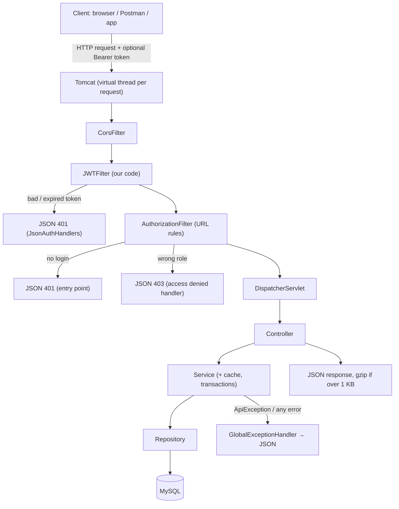

# 🛒 Ecommerce Backend — Spring Boot 4 + JWT Security

A production-style REST API for an e-commerce shop. It has stateless JWT login, role-based access, a paged and searchable product catalog, in-memory caching, Flyway database migrations, ImageKit image uploads, and the same JSON error format everywhere. It runs on Java 21 virtual threads.

Built with **Spring Boot 4.1 · Spring Security · Spring Data JPA (Hibernate) · MySQL · Flyway · Caffeine · MapStruct · JJWT · ImageKit**.

---

## 📑 Table of Contents

1. [Project Overview](#1-project-overview)
2. [What's New — Summary of Recent Updates](#2-whats-new--summary-of-recent-updates)
3. [Tech Stack & Dependencies](#3-tech-stack--dependencies)
4. [Project Structure](#4-project-structure)
5. [Domain Model & Database Schema](#5-domain-model--database-schema)
6. [The Big Picture — What Happens to Every Request?](#6-the-big-picture--what-happens-to-every-request)
7. [Security Configuration (`SecurityConfig`)](#7-security-configuration-securityconfig)
8. [JWT Authentication — Tokens Without a Database Lookup](#8-jwt-authentication--tokens-without-a-database-lookup)
9. [JSON Error Handling Inside the Security Filter (`JsonAuthHandlers`)](#9-json-error-handling-inside-the-security-filter-jsonauthhandlers)
10. [Global Exception Handling](#10-global-exception-handling)
11. [Role-Based Access Control (RBAC)](#11-role-based-access-control-rbac)
12. [Request Flows Step by Step](#12-request-flows-step-by-step)
13. [Product Catalog — Paging, Full-Text Search, Sorting](#13-product-catalog--paging-full-text-search-sorting)
14. [Caching (Caffeine)](#14-caching-caffeine)
15. [Database Query Optimization](#15-database-query-optimization)
16. [Database Migrations (Flyway)](#16-database-migrations-flyway)
17. [Virtual Threads & Server Tuning](#17-virtual-threads--server-tuning)
18. [Product Image Uploads (ImageKit)](#18-product-image-uploads-imagekit)
19. [DTOs, Records & MapStruct](#19-dtos-records--mapstruct)
20. [Concurrency & Stock Safety](#20-concurrency--stock-safety)
21. [Class-by-Class Reference](#21-class-by-class-reference)
22. [Configuration Reference (`application.yml`)](#22-configuration-reference-applicationyml)
23. [Complete API Reference](#23-complete-api-reference)
24. [How to Run Locally](#24-how-to-run-locally)
25. [Postman Walkthrough](#25-postman-walkthrough)
26. [Known Issues & Next Steps](#26-known-issues--next-steps)

---

## 1. Project Overview

Customers can register, sign in, browse and search products, manage a cart, and check out. Admins can also manage products (including image uploads), see every user and every open cart, and read system info.

**Main design decisions:**

| Decision | Why it matters |
|---|---|
| **Stateless JWT** | The server stores no sessions. Each request carries a signed token, so any server instance can handle it. |
| **User id and role inside the token** | The JWT filter builds the signed-in user from the token alone. Normal requests don't touch the database for authentication. |
| **Role-based access** | URL rules in `SecurityConfig`, plus "own account only" checks in controllers. |
| **One JSON error format** | Filters, controllers, and Tomcat's `/error` page all return `{ status, error, message, timestamp }`. |
| **Safe checkout** | Stock goes down with one atomic `UPDATE … WHERE stock >= qty`, so two buyers can't both get the last item. |
| **Flyway owns the schema** | Hibernate no longer changes tables. Every schema change is a versioned SQL file. |
| **Cached catalog** | Product reads come from memory for up to 30 s. Admin edits clear the cache straight away. |
| **Optimized queries** | `JOIN FETCH`, lazy relations, batch fetching, bulk deletes, and the right indexes. No N+1 queries on the hot paths. |
| **Virtual threads** | Waiting on MySQL or ImageKit doesn't hold an OS thread, so the server handles more requests at once. |

---

## 2. What's New — Summary of Recent Updates

| Area | What changed | Main files |
|---|---|---|
| 🔐 **Security config** | Stateless, CSRF/form login/basic auth turned off, URL role rules, CORS from an env var, JSON 401/403 handlers | `SecurityConfig`, `JsonAuthHandlers` |
| 🎫 **JWT** | Token now carries `uid` and `role`. One `parse()` checks signature and expiry. Signing key built once at startup. Older tokens fall back to a database lookup. | `JWTService`, `JWTFilter`, `UserPrincipal` |
| 🧯 **Filter error handling** | Bad or expired tokens get a JSON 401 straight from the filter instead of an HTML page or stack trace | `JWTFilter`, `JsonAuthHandlers`, `ApiError.toJson()` |
| 🚨 **Global exception handling** | `@RestControllerAdvice` maps business, auth, validation, upload, data-integrity, and pool-exhaustion errors to clean JSON | `GlobalExceptionHandler`, `ApiException`, `ApiError`, `CustomErrorController` |
| ⚡ **Caching** | Caffeine cache for catalog pages, categories, single products, and active products. Cleared on every product write. | `CacheConfig`, `ProductService` |
| 🔎 **Catalog API** | New paged endpoint with category filter, MySQL full-text search, whitelisted sorting, and category counts | `ProductCatalogRepository`, `CatalogQuery`, `PageResponse`, `CategoryCount` |
| 🗄️ **Query optimization** | `JOIN FETCH`, `LAZY` relations, `default_batch_fetch_size`, `getReferenceById`, bulk `DELETE`, `readOnly` transactions, `open-in-view: false`, HikariCP limits | Repositories, entities, `application.yml` |
| 🧱 **DB migrations** | Flyway with V1 to V4: base schema, wider columns, indexes, full-text index, unique email, unique cart line | `db/migration/*.sql` |
| 🧵 **Virtual threads** | `spring.threads.virtual.enabled: true` | `application.yml` |
| 🖼️ **Image upload** | Multipart upload to ImageKit with size, type, and magic-byte checks. Old file deleted after a successful save. | `ImageKitConfig`, `ImageUploadService`, `ProductController` |
| 📦 **Lighter responses** | `UserSummary` in cart and order responses instead of the full user. Gzip compression. | `UserSummary`, `CartItemMapper`, `OrderMapper` |
| 🛡️ **Account safety** | Register always creates a `CUSTOMER`. Email and password validated. Duplicate email → 409. Password never returned. Only admins can change roles. | `UserService`, `User` DTO |

---

## 3. Tech Stack & Dependencies

| Dependency | Purpose |
|---|---|
| Spring Boot 4.1 (`starter-web`) | Web framework, embedded Tomcat |
| Spring Security | Filter chain, authentication, authorization |
| Spring Data JPA / Hibernate | Repositories and ORM over MySQL |
| MySQL (`mysql-connector-j`) | Relational database (AWS RDS in production) |
| **Flyway** (`spring-boot-starter-flyway`, `flyway-mysql`) | Versioned database migrations |
| **Spring Cache + Caffeine** | Fast in-memory cache for product reads |
| JJWT 0.13 (`api`, `impl`, `jackson`) | Creating, signing, and parsing JWTs |
| **ImageKit Java SDK 3.7** | Product image hosting and CDN |
| MapStruct 1.5 | Entity ↔ DTO mapping, generated at compile time |
| Lombok 1.18 | Less boilerplate (`@Data`, getters and setters) |
| Spring Boot Actuator | `/actuator/health` and `/actuator/info` |
| Java 21 | LTS runtime with **virtual threads** |

---

## 4. Project Structure

```
src/main/java/com/ecom/
│
├── Main.java                              ← Spring Boot entry point
│
├── config/
│   ├── SecurityConfig.java                ← Filter chain, URL rules, CORS, password encoder
│   ├── CacheConfig.java          🆕       ← @EnableCaching + cache name constants
│   └── ImageKitConfig.java       🆕       ← ImageKit client bean (timeout, retries)
│
├── filter/
│   └── JWTFilter.java                     ← Reads and validates the JWT on every request
│
├── security/
│   └── JsonAuthHandlers.java     🆕       ← JSON 401/403 responses from the security layer
│
├── controller/
│   ├── UserController.java                ← /api/users/**
│   ├── ProductController.java             ← /api/products/** (+ catalog, categories, image)
│   ├── CartController.java                ← /api/cart/**
│   ├── OrderController.java               ← /api/order/**
│   ├── SystemController.java              ← /api/system/** (admin)
│   └── CustomErrorController.java         ← /error fallback, always JSON
│
├── service/
│   ├── UserService.java                   ← Register, login, profile updates
│   ├── ProductService.java                ← Product CRUD, catalog, caching
│   ├── CartService.java                   ← Add/remove items, stock checks
│   ├── OrderService.java                  ← Checkout (cart → order) in one transaction
│   ├── ImageUploadService.java   🆕       ← Validates and uploads images to ImageKit
│   ├── JWTService.java                    ← Token creation and parsing
│   └── MyUserDetailsService.java          ← Loads users by email for sign-in
│
├── repository/
│   ├── UserRepository.java
│   ├── ProductRepository.java             ← + atomic stock decrement, category counts
│   ├── ProductCatalogRepository.java 🆕   ← Native SQL: paging + full-text search + sort
│   ├── CartItemRepository.java            ← + JOIN FETCH queries, bulk deletes
│   └── OrderRepository.java
│
├── dto/                                   ← What the API sends and receives
│   ├── User.java · Address.java · Product.java
│   ├── CartItem.java · Order.java · OrderItem.java
│   ├── UserPrincipal.java                 ← Signed-in user (built from DB or from JWT)
│   ├── UserSummary.java          🆕       ← Small user object for carts and orders
│   ├── CatalogQuery.java         🆕       ← Cleaned catalog params (also the cache key)
│   ├── PageResponse.java         🆕       ← One page of results
│   ├── CategoryCount.java        🆕       ← { name, count }
│   └── UploadedImage.java        🆕       ← { url, fileId } from ImageKit
│
├── entity/                                ← JPA entities (database tables)
│   ├── UserEntity.java · AddressEntity.java · ProductEntity.java
│   └── CartItemEntity.java · OrderEntity.java · OrderItemEntity.java
│
├── enums/
│   ├── UserRole.java                      ← CUSTOMER, ADMIN
│   └── OrderStatus.java                   ← PENDING, CONFIRMED, SHIPPED, DELIVERED
│
├── mapper/                                ← MapStruct interfaces
│   ├── UserMapper.java · ProductMapper.java
│   └── CartItemMapper.java · OrderMapper.java
│
└── exception/
    ├── ApiException.java         🆕       ← Business error with an HTTP status
    ├── ApiError.java             🆕       ← The JSON error body (record)
    └── GlobalExceptionHandler.java 🆕     ← Maps every exception to JSON

src/main/resources/
├── application.yml
└── db/migration/                 🆕       ← Flyway scripts
    ├── V1__initial_schema.sql
    ├── V2__columns_and_indexes.sql
    ├── V3__unique_email.sql
    └── V4__unique_cart_line.sql
```

---

## 5. Domain Model & Database Schema

```
+------------------+        +--------------------+        +--------------------+
|   user_entity    |        |  cart_item_entity  |        |      products      |
|------------------|1     * |--------------------|*     1 |--------------------|
| id (PK)          +--------+ id (PK)            +--------+ id (PK)            |
| first_name       |        | user_id (FK)       |        | name               |
| last_name        |        | product_id (FK)    |        | description (TEXT) |
| email  (UNIQUE)  |        | quantity           |        | price              |
| password (BCrypt)|        | price              |        | stock_quantity     |
| phone            |        | created_at         |        | category           |
| role             |        | updated_at         |        | image_url          |
| address_id (FK)  |        | UNIQUE(user_id,    |        | image_file_id      |
| created_at       |        |        product_id) |        | active             |
| updated_at       |        +--------------------+        | created_at         |
+--------+---------+                                      | updated_at         |
         | 1                                              +--------------------+
         |              +------------------+
         |1           * |   order_entity   |1     * +--------------------+
         +--------------+ id (PK)          +--------+ order_item_entity  |
                        | user_id (FK)     |        | id (PK)            |
                        | total_amount     |        | order_id (FK)      |
                        | status           |        | product_id (FK)    |
                        | created_at       |        | quantity           |
                        | updated_at       |        | price              |
                        +------------------+        +--------------------+

+------------------+
|   user_address   |  ← optional 1:1 with user_entity (cascade ALL, orphan removal, LAZY)
| id, street, city, state, country, zipcode |
+------------------+
```

**Indexes and constraints (added by Flyway):**

| Name | Table | Columns | Used by |
|---|---|---|---|
| `uk_user_entity_email` | `user_entity` | `email` (unique) | Sign-in lookup, duplicate-email protection |
| `uk_cart_item_user_product` | `cart_item_entity` | `user_id, product_id` (unique) | "Is this product already in my cart?", stops duplicate lines |
| `idx_products_active_category` | `products` | `active, category` | Catalog filter, category counts |
| `ft_products_search` | `products` | FULLTEXT `name, category, description` | Catalog search (`MATCH … AGAINST`) |
| `idx_order_user_created` | `order_entity` | `user_id, created_at` | Order history, newest first |

**All relations are `LAZY`.** Related rows are only loaded when a query asks for them with `JOIN FETCH` (see [section 15](#15-database-query-optimization)).

---

## 6. The Big Picture — What Happens to Every Request?



**Rule of thumb:** if a filter rejects a request, it stops there. It never reaches a controller.

---

## 7. Security Configuration (`SecurityConfig`)

`SecurityConfig` describes the whole security setup in one place. Spring reads it once at startup.

### 7.1 What it turns on and off

```java
http.csrf(AbstractHttpConfigurer::disable)            // No cookies → CSRF attacks don't apply
    .cors(Customizer.withDefaults())                  // Use the corsConfigurationSource() bean
    .formLogin(form -> form.disable())                // No HTML login page
    .httpBasic(basic -> basic.disable())              // No browser username/password popup
    .sessionManagement(s -> s.sessionCreationPolicy(SessionCreationPolicy.STATELESS)) // Never create an HttpSession
    .exceptionHandling(ex -> ex
        .authenticationEntryPoint(JsonAuthHandlers.unauthorized())   // 401 as JSON
        .accessDeniedHandler(JsonAuthHandlers.forbidden()))          // 403 as JSON
    .addFilterBefore(jwtFilter, UsernamePasswordAuthenticationFilter.class) // Our JWT check runs first
    .authenticationProvider(daoAuthenticationProvider());            // Email + BCrypt password check
```

**In plain words:**
- **CSRF off:** CSRF attacks rely on the browser sending cookies automatically. This API uses an `Authorization` header that the browser never sends on its own, so CSRF protection isn't needed.
- **Stateless:** the server keeps no record of who is signed in. The token proves it on every request.
- **Form login / basic auth off:** this is a JSON API, so there are no login pages or popups.

### 7.2 URL rules (checked top to bottom, first match wins)

| Rule | Who |
|---|---|
| `OPTIONS /**` | Everyone (browser CORS preflight) |
| `POST /api/users/login`, `POST /api/users/register` | Everyone |
| `/error`, `/actuator/health` | Everyone |
| `/actuator/**`, `/api/system/**` | ADMIN |
| `GET /api/users/`, `GET /api/cart/`, `GET /api/products/` | ADMIN |
| `POST`, `PUT`, `DELETE /api/products/**` (includes image upload) | ADMIN |
| Anything else | Any signed-in user |

### 7.3 Beans it creates

| Bean | What it does |
|---|---|
| `securityFilterChain` | The filter chain above |
| `corsConfigurationSource` | Allowed origins come from `app.cors.allowed-origins` (env var `CORS_ALLOWED_ORIGINS`). Methods `GET POST PUT PATCH DELETE OPTIONS`. Headers `Authorization, Content-Type`. Preflight cached for 1 hour. |
| `daoAuthenticationProvider` | Uses `MyUserDetailsService` to find the user by email and `BCryptPasswordEncoder` to check the password |
| `passwordEncoder` | `BCryptPasswordEncoder(10)`: slow on purpose, salted hashes |
| `authenticationManager` | Used by `UserService.login()` |

### 7.4 CORS in one minute

When the React app at `http://localhost:5173` calls this API on port `5000`, the browser first sends an `OPTIONS` "preflight" request to ask whether that's allowed. To add a frontend, change the env var. No rebuild needed:

```bash
CORS_ALLOWED_ORIGINS=http://localhost:5173,https://myshop.example.com
```

---

## 8. JWT Authentication — Tokens Without a Database Lookup

### 8.1 What's inside the token

`JWTService.generateToken(userId, email, role)` builds:

| Part | Content |
|---|---|
| Header | `{"alg":"HS256"}` |
| Payload | `{"sub":"alice@example.com","uid":7,"role":"CUSTOMER","iat":…,"exp":…}` |
| Signature | HMAC-SHA256 of header + payload, using the secret key |

- **Valid for 30 minutes** (`VALIDITY_MS`).
- **The signing key is built once** in the constructor (`Keys.hmacShaKeyFor(...)`), not on every call.
- The payload is **Base64, not encrypted**. Anyone can read it, but nobody can change it without the secret.

### 8.2 How `JWTFilter` uses it (new, faster flow)

```
Authorization header missing or not "Bearer …"?
  └─ YES → pass the request on (public URLs still work; protected ones get 401 later)

claims = jwtService.parse(token)     ← ONE call checks the signature AND the expiry
  └─ JwtException / IllegalArgumentException → JSON 401 "Your session has expired. Sign in again."  (STOP)

Is anyone already authenticated in this request?
  └─ NO →
       principal = UserPrincipal.fromToken(uid, sub, role)     ← built from claims, NO database query
       if the token has no uid/role (issued before this update):
            principal = MyUserDetailsService.loadUserByUsername(sub)   ← one-time fallback query
            └─ not found → JSON 401 "Your account could not be found. Sign in again." (STOP)
       SecurityContextHolder.setAuthentication(principal, roles)

filterChain.doFilter(...)            ← continue to the URL rules and the controller
```

**Why this matters:** before, every request ran `SELECT … FROM user_entity WHERE email = ?`. Now a normal request skips that query entirely.

> [!NOTE]
> **Trade-off:** the role and id come from the token. If an admin changes someone's role, or an account is deleted, the change takes effect when that user's current token expires (at most 30 minutes) or when they sign in again.

### 8.3 `UserPrincipal` — two ways to build it

| Constructor | When | Password? |
|---|---|---|
| `new UserPrincipal(UserEntity)` | Sign-in (Spring needs the hash to compare) | Yes (BCrypt hash) |
| `UserPrincipal.fromToken(id, email, role)` | Every other request | No (`null`) |

It returns `ROLE_ADMIN` or `ROLE_CUSTOMER` as its authority, so `hasRole("ADMIN")` works. Controllers get it with `@AuthenticationPrincipal UserPrincipal principal`, so **user identity always comes from the verified token**, never from a header or the request body. The old `X-User-ID` header is no longer read.

### 8.4 Login no longer runs an extra query

```java
Authentication auth = authenticationManager.authenticate(new UsernamePasswordAuthenticationToken(email, password));
UserPrincipal principal = (UserPrincipal) auth.getPrincipal();   // already has id + role
return jwtService.generateToken(principal.getId(), principal.getUsername(), principal.getRole());
```

---

## 9. JSON Error Handling Inside the Security Filter (`JsonAuthHandlers`)

### The problem

Security filters run **before** Spring MVC. `@RestControllerAdvice` (the global exception handler) can't see errors that happen there. Without extra work, a bad token would produce an HTML error page, an empty body, or a stack trace.

### The solution

`JsonAuthHandlers` is a small utility class with three pieces:

| Member | Used for | Status | Message |
|---|---|---|---|
| `unauthorized()` → `AuthenticationEntryPoint` | Protected URL called with **no** valid login | 401 | "Sign in to continue." |
| `forbidden()` → `AccessDeniedHandler` | Signed in but **wrong role** (e.g. customer calls an admin URL) | 403 | "You don't have permission to do that." |
| `write(response, status, message)` | Called directly from `JWTFilter` for bad or expired tokens and deleted accounts | 401 | Custom message |

```java
public static void write(HttpServletResponse response, HttpStatus status, String message) throws IOException {
    if (response.isCommitted()) return;                       // never write twice
    response.setStatus(status.value());
    response.setCharacterEncoding("UTF-8");
    response.setContentType("application/json");
    response.getWriter().write(ApiError.of(status.value(), status.getReasonPhrase(), message).toJson());
}
```

**Why `ApiError.toJson()` writes JSON by hand:** it keeps filter-level errors independent of Spring MVC's message converters. It also escapes quotes, backslashes, and control characters, so a message can never break the JSON.

After `write(...)`, the filter **returns without calling `filterChain.doFilter`**, so the request stops there.

---

## 10. Global Exception Handling

There are three layers. Together they guarantee that **every** error, wherever it happens, comes back in the same shape:

```json
{
  "status": 404,
  "error": "Not Found",
  "message": "Product not found.",
  "timestamp": "2026-11-24T18:01:22.123Z"
}
```

```
Layer 1  Security filters        → JsonAuthHandlers         (bad token, no login, wrong role)
Layer 2  Controllers & services  → GlobalExceptionHandler   (everything thrown inside Spring MVC)
Layer 3  Anything else           → CustomErrorController    (Tomcat's /error forward, last resort)
```

### 10.1 `ApiException` — throwing business errors

Services throw it with a status and a message the user can understand:

```java
throw ApiException.badRequest("Quantity must be at least 1.");          // 400
throw ApiException.forbidden("You can only view or change your own account."); // 403
throw ApiException.notFound("Product not found.");                      // 404
throw ApiException.conflict("Only 3 of Headphones in stock.");          // 409
throw new ApiException(HttpStatus.BAD_GATEWAY, "Couldn't reach the image service."); // any status
```

### 10.2 `GlobalExceptionHandler` — what maps to what

| Exception | Status | Message sent to the client |
|---|---|---|
| `ApiException` | Its own status | Its own message |
| `BadCredentialsException`, `DisabledException` | 401 | "Email or password is incorrect." |
| `HttpMessageNotReadableException` | 400 | "The request body is missing or isn't valid JSON." |
| `MethodArgumentTypeMismatchException`, `MissingServletRequestParameterException` | 400 | "A request parameter is missing or has the wrong type." |
| `AccessDeniedException` | 403 | "You don't have permission to do that." |
| `DataIntegrityViolationException` | 400 | "Some details are too long or not allowed…" (logged as a warning) |
| `MaxUploadSizeExceededException` | 413 | "The file is too large. The limit is 5 MB." |
| `MissingServletRequestPartException` | 400 | "Choose an image to upload." |
| `MultipartException` | 400 | "The upload couldn't be read. Send the image as multipart/form-data." |
| `CannotCreateTransactionException`, `DataAccessResourceFailureException` | **503** | "The shop is busy right now. Try again in a moment." |
| Spring's own `ErrorResponse` types (unknown path, wrong method…) | Their own 4xx | Standard reason phrase |
| Any other `Exception` | 500 | "Something went wrong on the server." (full stack trace **logged**, never sent) |

**Points worth knowing:**
- **503 on pool exhaustion:** if no database connection frees up within 5 s (`hikari.connection-timeout`), the user gets a friendly "busy" message instead of a crash.
- **Internals stay hidden:** the 500 handler logs the details for you and sends only a generic message to the client.

### 10.3 `CustomErrorController`

It handles `/error`, where Tomcat forwards errors that happen outside controllers. It reads the status code from the request and returns the same `ApiError` JSON. 5xx errors always say "Something went wrong on the server."

### 10.4 Common error scenarios

| Scenario | Handled by | Status |
|---|---|---|
| Expired or tampered JWT | `JWTFilter` → `JsonAuthHandlers.write` | 401 |
| Old token for a deleted account | `JWTFilter` | 401 |
| No token on a protected URL | `JsonAuthHandlers.unauthorized` | 401 |
| Customer calls an admin URL | `JsonAuthHandlers.forbidden` | 403 |
| Wrong email or password | `GlobalExceptionHandler` | 401 |
| Register with an email that's taken | `ApiException.conflict` | 409 |
| Add more than the stock to the cart | `ApiException.conflict` | 409 |
| Checkout with an empty cart | `ApiException.badRequest` | 400 |
| Image over 5 MB | `GlobalExceptionHandler` / `ImageUploadService` | 413 |
| DB pool exhausted | `GlobalExceptionHandler` | 503 |
| Unknown URL | Spring → `GlobalExceptionHandler` / `CustomErrorController` | 404 |

---

## 11. Role-Based Access Control (RBAC)

There are two roles: `CUSTOMER` (the default) and `ADMIN`.

1. **URL level** → `SecurityConfig` ([section 7.2](#72-url-rules-checked-top-to-bottom-first-match-wins)).
2. **Ownership level** → `UserController.requireSelfOrAdmin(id, principal)`. Customers can only read or update **their own** account.
3. **Product visibility** → `GET /api/products/{id}`: admins can open hidden products, customers only see active ones.
4. **Role escalation protection:**
   - Register **always** sets `role = CUSTOMER`, whatever the client sends.
   - `PUT /api/users/{id}` clears `role` unless the caller is an admin. It **never** changes `email` (the JWT subject) or `password` (it would be stored unhashed).
   - The `User` DTO has **no default role**. A default would silently demote admins on every partial update.

**Making the first admin:**

```sql
UPDATE user_entity SET role = 'ADMIN' WHERE email = 'admin@example.com';
```

After that, an admin can promote others with `PUT /api/users/{id}` `{"role":"ADMIN"}`. The promoted user must **sign in again** to get a token with the new role.

---

## 12. Request Flows Step by Step

### 12.1 Register — `POST /api/users/register` (public)

```
JWTFilter: no header → pass   →   URL is permitAll   →   UserController.createUser
UserService.createUser  (@Transactional)
  ├─ email trimmed + regex check            → 400 "Enter a valid email address."
  ├─ password ≥ 6 chars                     → 400
  ├─ first name required                    → 400
  ├─ email already used?                    → 409 (also protected by the UNIQUE index)
  ├─ role = CUSTOMER, password = BCrypt(...)
  ├─ save
  └─ token = generateToken(id, email, role)
201 → { "student": { …user without password… }, "token": "eyJ…" }
```

> The response key is `student` for backwards compatibility with the existing frontend.

### 12.2 Login — `POST /api/users/login` (public)

```
AuthenticationManager → DaoAuthenticationProvider → MyUserDetailsService.loadUserByUsername(email)
  → indexed lookup on email → UserPrincipal(with hash) → BCrypt compare
  ├─ mismatch → BadCredentialsException → 401 "Email or password is incorrect."
  └─ match    → token from the principal's id + role (no extra query)
201 → "eyJhbGciOi…"   (the body is the raw token string)
```

### 12.3 Protected request — `GET /api/cart/items`

```
JWTFilter: parse token (signature + expiry) → UserPrincipal.fromToken(...)   [no DB]
AuthorizationFilter: authenticated → OK
CartController.getCart(@AuthenticationPrincipal principal)
CartService.getCart(principal.getId())   (@Transactional(readOnly = true))
  → ONE query: cart lines JOIN FETCH product
200 → [ { id, user: {id, firstName, lastName, email}, product: {...}, quantity, price } ]
```

### 12.4 Add to cart — `POST /api/cart/`

```
validate product id + quantity ≥ 1
product = findByIdAndActiveTrue(id)                  → 404 if hidden or missing
existing = findByUserIdAndProductId(user, product)   → uses the unique index from V4
if (alreadyInCart + quantity > stock)                → 409 "Only N of X in stock." / "X is sold out."
new line? user = getReferenceById(userId)            → sets the FK without loading the user
line.quantity += quantity; line.price = price × quantity; save
```

### 12.5 Checkout — `POST /api/order/` (one transaction)

```
@Transactional createOrder(userId)
  ├─ load user                                           → 404 if missing
  ├─ cart = findByUserIdWithProduct(userId)  (1 query)   → 400 if empty
  ├─ for each line:
  │    ├─ product inactive?                              → 409
  │    ├─ decrementStock(id, qty)  (atomic UPDATE)       → 0 rows? 409 "Not enough stock…"
  │    └─ OrderItem at the CURRENT price
  ├─ save order (status CONFIRMED, items cascade)
  └─ clearCart(userId)  → one bulk DELETE
201 → Order { id, user (summary), totalAmount, status, items[] }

If anything fails → everything rolls back: stock, order, and cart stay as they were.
```

---

## 13. Product Catalog — Paging, Full-Text Search, Sorting

### 13.1 Endpoint

```
GET /api/products/catalog?page=0&size=24&category=Audio&q=sony headphones&sort=price-asc
```

| Param | Default | Rules |
|---|---|---|
| `page` | `0` | 0 to 10,000 |
| `size` | `24` | 1 to 60 |
| `category` | none | Exact match, trimmed, max 100 chars |
| `q` | none | Search text, trimmed, max 100 chars |
| `sort` | `featured` | `featured`, `price-asc`, `price-desc`, `name`, `newest`. Anything else becomes `featured`. |

**Response (`PageResponse<Product>`):**

```json
{ "content": [ … ], "page": 0, "size": 24, "totalElements": 120, "totalPages": 5, "last": false }
```

### 13.2 `CatalogQuery` — clean input, safe cache key

`CatalogQuery.of(...)` clamps numbers, trims text, turns blanks into `null`, and whitelists `sort`. It's a Java **record**, so two queries with the same values are equal. That makes it a good **cache key**: identical searches hit the same cache entry.

### 13.3 How search works (`ProductCatalogRepository`)

It uses native SQL because MySQL's `MATCH … AGAINST` full-text search has no JPQL equivalent.

```
"Sony WH-1000XM5 headphones"
      ↓ toBooleanQuery()
"+sony* +1000xm5* +headphones*"     ← every word required, each matched as a prefix
                                       words < 3 chars and InnoDB stopwords are dropped
```

| Case | Strategy |
|---|---|
| Latin (ASCII) text with usable words | `MATCH(name, category, description) AGAINST (:ft IN BOOLEAN MODE)` using the `ft_products_search` index |
| Non-Latin text (e.g. Sinhala), only short words, or only stopwords | `LOWER(name) LIKE :like`, with `%`, `_`, and `\` escaped |

**Sorting:**
- `featured` while searching → best match first, then in stock, then newest
- `featured` without search → in stock first, then newest
- The others sort by price, name, or `created_at`, with `id` as a tie-breaker so pages stay stable

**Security:** only **values** are bound as parameters. `ORDER BY` comes from a fixed `switch`, so client text is never pasted into SQL, and SQL injection isn't possible.

A second `SELECT COUNT(*)` with the same `WHERE` gives `totalElements`.

### 13.4 Categories

```
GET /api/products/categories  →  [ { "name": "Audio", "count": 4 }, { "name": "Laptops", "count": 2 } ]
```

This is one `GROUP BY` query over active products, biggest category first. The result is cached.

---

## 14. Caching (Caffeine)

### 14.1 What caching means here

The first time someone asks for a catalog page, the app queries MySQL and **keeps the answer in memory**. For the next 30 seconds, the same request is answered from memory: no database, close to zero latency.

### 14.2 Setup

```java
@Configuration
@EnableCaching                        // turns on @Cacheable / @CacheEvict
public class CacheConfig {
    public static final String CATALOG = "catalog";
    public static final String CATEGORIES = "categories";
    public static final String PRODUCT = "product";
    public static final String ACTIVE_PRODUCTS = "activeProducts";
}
```

```yaml
spring:
  cache:
    type: caffeine
    cache-names: catalog,categories,product,activeProducts
    caffeine:
      spec: maximumSize=2000,expireAfterWrite=30s   # max 2000 entries per cache, each lives 30 s
```

### 14.3 What is cached

| Method | Cache | Key |
|---|---|---|
| `getCatalog(CatalogQuery)` | `catalog` | The whole `CatalogQuery` record |
| `getCategories()` | `categories` | (no args) |
| `getActiveProduct(id)` | `product` | Product id |
| `findActiveProducts()` | `activeProducts` | (no args) |
| `getAnyProduct`, `getAllProducts`, `searchProducts` | **not cached** | Admin views and legacy search always read live data |

### 14.4 Keeping it fresh

Every product **write** clears all four caches:

```java
@CacheEvict(cacheNames = {CATALOG, CATEGORIES, PRODUCT, ACTIVE_PRODUCTS}, allEntries = true)
public Product createProduct(...)  /  updateProduct(...)  /  updateImage(...)  /  deleteProduct(...)
```

So **admins see their edits immediately**.

> [!NOTE]
> Stock changes from orders **don't** clear the cache, which would happen on every checkout. A product page may show a stock count up to 30 s old, but **add-to-cart and checkout always check live stock**, so overselling is impossible.

> [!TIP]
> Caffeine is a per-instance, in-memory cache. If you run several app instances behind a load balancer, each has its own cache (still at most 30 s stale). To share one cache, switch to Redis.

---

## 15. Database Query Optimization

| Technique | Where | What it fixes |
|---|---|---|
| **`JOIN FETCH`** | `CartItemRepository.findByUserIdWithProduct`, `findAllWithProductAndUser` | Avoids **N+1**: a cart with 10 items is now 1 query instead of 11 |
| **`FetchType.LAZY` on every relation** | `CartItemEntity.user/product`, `OrderEntity.user`, `OrderItemEntity.product/order`, `UserEntity.address` | Related rows load only when needed. Sign-in no longer loads the address. |
| **`@ToString.Exclude` / `@EqualsAndHashCode.Exclude`** | Lazy fields | Lombok's `toString()` and `equals()` can't trigger hidden lazy loads or infinite loops |
| **`default_batch_fetch_size: 32`** | `application.yml` | When lazy rows must load (e.g. order items' products), Hibernate fetches up to 32 per query with `IN (…)` instead of one each |
| **`getReferenceById(userId)`** | `CartService.addToCart` | Sets the foreign key without a `SELECT` on the user |
| **Bulk `@Modifying` deletes** | `deleteLine`, `deleteAllByUserId` | Deletes in one SQL statement instead of load-then-delete per row. `deleteLine` returns 0 or 1, so "not in cart" → 404 needs no extra query. |
| **Atomic `UPDATE` for stock** | `ProductRepository.decrementStock` | No read-modify-write race. One statement. |
| **`@Transactional(readOnly = true)`** | All read services | Hibernate skips dirty checking. The driver can optimize. |
| **`open-in-view: false`** | `application.yml` | The DB connection goes back to the pool as soon as the service method ends, not after the JSON is written |
| **Indexes** (Flyway V2 to V4) | `products`, `order_entity`, `user_entity`, `cart_item_entity` | Catalog filter, full-text search, sign-in, and cart lookups are index lookups, not table scans |
| **HikariCP limits** | `maximum-pool-size: 20`, `minimum-idle: 5`, `connection-timeout: 5000` | Caps DB connections (keep pool × instances below RDS `max_connections`) and fails fast with a 503 instead of hanging |
| **Slow work outside transactions** | `ProductService.updateImage` is **not** `@Transactional` | The ImageKit upload (slow network call) doesn't hold a DB connection |
| **`UserSummary` in cart and order responses** | `CartItemMapper`, `OrderMapper` | Only `id, firstName, lastName, email` is mapped. Address, role, and dates aren't loaded or sent. |
| **Gzip compression** | `server.compression` | JSON over 1 KB is compressed. Product lists shrink a lot. |

**N+1, explained simply:** "Give me my cart" → 1 query for cart lines, then 1 query **per line** for its product. With `JOIN FETCH`, the database returns lines and products together in **one** query.

---

## 16. Database Migrations (Flyway)

### 16.1 Why

Before, `ddl-auto: update` let Hibernate change tables on its own. That's risky in production: no history, no review, and it can't create things like full-text indexes. Now **Flyway** applies versioned SQL files in order and records each one in the `flyway_schema_history` table. Hibernate is set to `ddl-auto: none`.

### 16.2 The migrations

| Version | File | What it does |
|---|---|---|
| **V1** | `V1__initial_schema.sql` | Creates all tables exactly as Hibernate used to (for **new, empty** databases) |
| **V2** | `V2__columns_and_indexes.sql` | `description` → `TEXT`, `image_url` → `VARCHAR(1000)`. Adds `idx_products_active_category`, FULLTEXT `ft_products_search`, `idx_order_user_created`. |
| **V3** | `V3__unique_email.sql` | `UNIQUE(email)`: one account per email, and fast sign-in lookups |
| **V4** | `V4__unique_cart_line.sql` | `UNIQUE(user_id, product_id)`: one cart line per product per user |

### 16.3 Existing database? Baseline

```yaml
spring:
  flyway:
    enabled: true
    baseline-on-migrate: true   # DB has tables but no Flyway history → mark V1 as done
    baseline-version: 1         # …then run V2, V3, V4
```

> [!WARNING]
> **V3 and V4 fail if duplicates already exist.** Check before deploying:
> ```sql
> SELECT email, COUNT(*) FROM user_entity GROUP BY email HAVING COUNT(*) > 1;
> SELECT user_id, product_id, COUNT(*) FROM cart_item_entity GROUP BY user_id, product_id HAVING COUNT(*) > 1;
> ```
> Remove or merge the duplicates, then start the app.

### 16.4 Changing the schema from now on

1. Create `src/main/resources/db/migration/V5__short_description.sql`.
2. Write plain SQL (`ALTER TABLE …`).
3. Restart the app. Flyway runs it once.

**Never edit a migration that has already run.** Flyway stores a checksum and refuses to start if a file changes. Add a new version instead.

---

## 17. Virtual Threads & Server Tuning

### 17.1 Virtual threads (Java 21)

```yaml
spring:
  threads:
    virtual:
      enabled: true
```

**Simple explanation:** normally Tomcat has a pool of about 200 **OS threads**. Each request holds one, even while it's just *waiting* for MySQL or ImageKit. When all 200 are waiting, new requests queue.

With **virtual threads**, each request gets a very cheap thread managed by the JVM. When it waits on I/O, the JVM *parks* it and frees the OS thread for other work. You can have thousands of concurrent requests without thousands of OS threads.

| | Platform threads | Virtual threads |
|---|---|---|
| Cost per thread | ~1 MB stack, OS-managed | A few KB, JVM-managed |
| While waiting on DB/HTTP | Holds an OS thread | Releases it |
| Practical limit | Hundreds | Thousands or more |
| Code changes needed | — | **None.** It's one config flag. |

> [!IMPORTANT]
> Virtual threads don't create more **database connections**. The HikariCP pool (20) is still the real limit for DB work. That's why `connection-timeout: 5000` and the 503 "shop is busy" handler exist.

### 17.2 Other server settings

| Setting | Value | Why |
|---|---|---|
| `server.compression.enabled` | `true` (JSON/text ≥ 1 KB) | Smaller responses, faster pages |
| `server.shutdown` | `graceful` | In-flight requests finish before the app stops (up to 20 s, `timeout-per-shutdown-phase`) |
| `spring.servlet.multipart.max-file-size` | `5MB` | Image limit |
| `spring.servlet.multipart.max-request-size` | `6MB` | Whole multipart request limit |
| `server.tomcat.max-swallow-size` | `10MB` | Tomcat reads past an oversized upload, so the client gets a clean 413 JSON instead of a dropped connection |

---

## 18. Product Image Uploads (ImageKit)

```
POST /api/products/{id}/image     (ADMIN, multipart/form-data, field name "file")
```

**`ImageKitConfig`** creates one `ImageKitClient` bean: private key from config, 60 s timeout, 2 retries, closed on shutdown. Startup fails fast if the key is missing.

**`ImageUploadService.upload(file, productName)` checks, in order:**

1. File present → else 400 "Choose an image to upload."
2. Size ≤ 5 MB → else 413.
3. Content type is JPEG, PNG, WebP, GIF, or AVIF → else 400.
4. **Magic bytes:** the first bytes of the file must really match an image signature. A renamed `.exe` is rejected even if the browser says `image/png`.
5. File name = slug of the product name (`"Wireless Headphones!"` → `wireless-headphones.jpg`). ImageKit adds a unique suffix.
6. Upload to the configured folder (`/products`) with the tag `product`.
7. ImageKit errors → **502 Bad Gateway** with a friendly message (logged with details).

**`ProductService.updateImage` flow (no orphaned files):**

```
upload new image ─► save url + fileId on the product
                     ├─ save fails → delete the NEW image from ImageKit, rethrow
                     └─ save OK   → delete the OLD image from ImageKit (quietly)
clear product caches
```

`deleteQuietly` logs failures but never throws, so a cleanup problem can't break a successful save. If an admin replaces `imageUrl` by hand through `PUT /api/products/{id}`, the old ImageKit file is deleted too.

---

## 19. DTOs, Records & MapStruct

### 19.1 Entities vs DTOs

- **Entities** (`*Entity`) = database tables. Never returned directly.
- **DTOs** = what the API sends and receives. Sensitive fields are protected:
  - `User.password` is `@JsonProperty(access = WRITE_ONLY)`: accepted in requests, **never** in responses.
  - `ProductMapper` ignores `imageFileId`, so clients can't set or see ImageKit internals.

### 19.2 New small types (Java records)

| Type | Purpose |
|---|---|
| `CatalogQuery` | Cleaned catalog params + cache key |
| `PageResponse<T>` | `content, page, size, totalElements, totalPages, last` |
| `CategoryCount` | `{ name, count }` |
| `UploadedImage` | `{ url, fileId }` from ImageKit |
| `ApiError` | The error body |
| `UserSummary` (class) | `id, firstName, lastName, email`, used inside cart lines and orders |

Records are immutable and compare by value: a short way to write "just data".

### 19.3 Mappers

| Mapper | Notes |
|---|---|
| `UserMapper` | `toUserDto`, `toUserEntity`, `toUserSummary`. `updateUserEntityFromDto` ignores `id`, `address.id`, `createdAt`, `updatedAt`. |
| `ProductMapper` | Ignores `imageFileId` both ways |
| `CartItemMapper` | Entity → DTO only. Uses `UserMapper.toUserSummary` + `ProductMapper`. |
| `OrderMapper` | Entity → DTO only (orders are built in `OrderService`, never from request JSON) |

`NullValuePropertyMappingStrategy.IGNORE` on `UserMapper` and `ProductMapper` enables **partial updates**: fields sent as `null` (or left out) keep their stored values.

---

## 20. Concurrency & Stock Safety

```java
@Modifying
@Query("UPDATE products p SET p.stockQuantity = p.stockQuantity - :qty WHERE p.id = :id AND p.stockQuantity >= :qty")
int decrementStock(@Param("id") Long id, @Param("qty") int qty);   // 1 = reserved, 0 = not enough
```

- **One SQL statement:** MySQL locks the row, so when two checkouts race for the last item, exactly one gets `1` and the other gets `0` → 409.
- **`@Transactional` on `createOrder`:** if line 3 fails, the stock taken for lines 1 and 2 is **rolled back**.
- **Add-to-cart checks the new total** (`alreadyInCart + quantity > stock`), not just the amount being added.
- **Unique `(user_id, product_id)`** stops two parallel "add" requests from creating duplicate cart lines.
- **Customers pay the current price** at checkout, not the price saved when the item went into the cart.

---

## 21. Class-by-Class Reference

| Class | Responsibility |
|---|---|
| `Main` | Starts Spring Boot |
| `SecurityConfig` | Filter chain, URL rules, CORS, BCrypt, auth provider, `AuthenticationManager` |
| `CacheConfig` | Enables caching. Holds cache name constants. |
| `ImageKitConfig` | Builds the ImageKit client |
| `JWTFilter` | Parses the token once, builds `UserPrincipal` from claims (DB fallback for old tokens), writes JSON 401 on failure |
| `JsonAuthHandlers` | JSON 401 entry point, JSON 403 handler, `write()` helper |
| `JWTService` | `generateToken(id, email, role)`, `parse(token)`, `extractUserName(token)`. Key built once. |
| `MyUserDetailsService` | Loads a user by email for sign-in |
| `UserService` | Register (validation, BCrypt, forced CUSTOMER), login, get and update users |
| `ProductService` | Cached reads, cache-evicting writes, image replacement, soft delete |
| `ImageUploadService` | Validates and uploads images, deletes old ones |
| `CartService` | Add (stock-checked, merges lines), remove (bulk delete), view (JOIN FETCH), clear |
| `OrderService` | Transactional checkout with atomic stock reservation |
| `ProductCatalogRepository` | Native SQL catalog: filter, full-text or LIKE search, whitelisted sort, count |
| `ProductRepository` | Active product lookups, legacy search, category counts, `decrementStock` |
| `CartItemRepository` | Line lookup, JOIN FETCH lists, bulk deletes |
| `UserRepository` / `OrderRepository` | Standard JPA repositories |
| `GlobalExceptionHandler` | Maps exceptions to `ApiError` JSON |
| `ApiException` / `ApiError` | Business error type / JSON error body (with safe hand-written JSON) |
| `CustomErrorController` | JSON for Tomcat's `/error` |
| `UserPrincipal` | Signed-in user, from the DB (sign-in) or from the token (every other request) |
| `SystemController` | Admin-only OS/Java info |

---

## 22. Configuration Reference (`application.yml`)

```yaml
server:
  port: ${PORT:5000}
  compression: { enabled: true, mime-types: application/json,text/plain, min-response-size: 1KB }
  shutdown: graceful
  tomcat: { max-swallow-size: 10MB }

spring:
  threads.virtual.enabled: true                 # Java 21 virtual threads
  lifecycle.timeout-per-shutdown-phase: 20s
  servlet.multipart: { max-file-size: 5MB, max-request-size: 6MB }
  datasource:
    url: ${DB_URL}                              # use env vars, never commit real values
    username: ${DB_USERNAME}
    password: ${DB_PASSWORD}
    hikari: { maximum-pool-size: ${DB_POOL_SIZE:20}, minimum-idle: 5, connection-timeout: 5000 }
  jpa:
    open-in-view: false
    hibernate.ddl-auto: none                    # Flyway owns the schema
    show-sql: ${SHOW_SQL:false}
    properties.hibernate.default_batch_fetch_size: 32
  flyway: { enabled: true, baseline-on-migrate: true, baseline-version: 1 }
  cache:
    type: caffeine
    cache-names: catalog,categories,product,activeProducts
    caffeine.spec: maximumSize=2000,expireAfterWrite=30s

jwt.secret: ${JWT_SECRET}                       # openssl rand -base64 32

imagekit:
  private-key: ${IMAGEKIT_PRIVATE_KEY}
  folder: ${IMAGEKIT_FOLDER:/products}
  max-file-size-bytes: 5242880

app.cors.allowed-origins: ${CORS_ALLOWED_ORIGINS:http://localhost:5173}

management:
  endpoints.web.exposure.include: health,info   # never expose env / heapdump
  endpoint.health: { show-details: when-authorized, roles: ADMIN }
```

**Environment variables** (see `.env.example`):

| Variable | Example |
|---|---|
| `DB_URL` | `jdbc:mysql://your-rds-host:3306/ecommerce` |
| `DB_USERNAME` / `DB_PASSWORD` | Your DB credentials |
| `DB_POOL_SIZE` | `20` |
| `JWT_SECRET` | Output of `openssl rand -base64 32` |
| `CORS_ALLOWED_ORIGINS` | `http://localhost:5173,https://your-shop.com` |
| `IMAGEKIT_PRIVATE_KEY` | From ImageKit → Developer options → API keys |
| `IMAGEKIT_FOLDER` | `/products` |
| `PORT` | `5000` |

> [!CAUTION]
> Never commit real database passwords, JWT secrets, or ImageKit private keys. If one was ever committed, treat it as public: **rotate it** and move it to an environment variable.

---

## 23. Complete API Reference

**Legend:** ❌ public · 🔑 any signed-in user · 🔐 ADMIN

### Auth

| Method | URL | Auth | Description |
|---|---|---|---|
| `POST` | `/api/users/register` | ❌ | Register → `{ student, token }` (201) |
| `POST` | `/api/users/login` | ❌ | Sign in → raw JWT string (201) |

### Users

| Method | URL | Auth | Description |
|---|---|---|---|
| `GET` | `/api/users/` | 🔐 | All users |
| `GET` | `/api/users/me` | 🔑 | Your own profile |
| `GET` | `/api/users/{id}` | 🔑 self / 🔐 | One user |
| `PUT` | `/api/users/{id}` | 🔑 self / 🔐 | Partial update. Email and password locked. Role: admin only. |

### Products

| Method | URL | Auth | Description |
|---|---|---|---|
| `GET` | `/api/products/catalog` | 🔑 | 🆕 Paged, filtered, searchable, sortable listing (cached) |
| `GET` | `/api/products/categories` | 🔑 | 🆕 Categories with counts (cached) |
| `GET` | `/api/products/{id}` | 🔑 | 🆕 One product (customers: active only, cached; admins: any) |
| `GET` | `/api/products/active` | 🔑 | All active products (cached) |
| `GET` | `/api/products/search?keyword=` | 🔑 | Legacy name search (active, in stock) |
| `GET` | `/api/products/` | 🔐 | All products, including hidden |
| `POST` | `/api/products/` | 🔐 | Create |
| `PUT` | `/api/products/{id}` | 🔐 | Partial update |
| `DELETE` | `/api/products/{id}` | 🔐 | Soft delete (`active = false`) |
| `POST` | `/api/products/{id}/image` | 🔐 | 🆕 Upload image (multipart, field `file`, ≤ 5 MB) |

### Cart

| Method | URL | Auth | Description |
|---|---|---|---|
| `GET` | `/api/cart/items` | 🔑 | Your cart |
| `POST` | `/api/cart/` | 🔑 | Add `{ "product": { "id": 1 }, "quantity": 2 }` |
| `DELETE` | `/api/cart/{productId}` | 🔑 | Remove a line (404 if it's not in your cart) |
| `GET` | `/api/cart/` | 🔐 | Every user's cart lines |

### Orders

| Method | URL | Auth | Description |
|---|---|---|---|
| `POST` | `/api/order/` | 🔑 | Checkout your cart (201) |

### System

| Method | URL | Auth | Description |
|---|---|---|---|
| `GET` | `/actuator/health` | ❌ | Health (details for admins) |
| `GET` | `/actuator/info` | 🔐 | App info |
| `GET` | `/api/system/info` | 🔐 | OS/Java info |

---

## 24. How to Run Locally

### Prerequisites
- Java 21+
- Maven 3.8+
- MySQL 8+

### Steps

```sql
-- 1. Create an empty database (Flyway creates the tables)
CREATE DATABASE ecommerce;
```

```bash
# 2. Set environment variables (or add them to your IntelliJ run configuration)
export DB_URL=jdbc:mysql://localhost:3306/ecommerce
export DB_USERNAME=root
export DB_PASSWORD=your-password
export JWT_SECRET=$(openssl rand -base64 32)
export IMAGEKIT_PRIVATE_KEY=private_xxx
export CORS_ALLOWED_ORIGINS=http://localhost:5173

# 3. Run
mvn clean spring-boot:run

# or build a jar
mvn clean package -DskipTests
java -jar target/EcommerceApp-1.0-SNAPSHOT.jar
```

On startup, **Flyway** runs V1 to V4 on an empty database (or baselines an existing one and runs V2 to V4). The server listens on port **5000** (override with `PORT`).

---

## 25. Postman Walkthrough

```http
### 1. Register
POST http://localhost:5000/api/users/register
Content-Type: application/json

{ "firstName": "Alice", "lastName": "Smith", "email": "alice@example.com", "password": "secret123" }

### 2. Login (response body = token)
POST http://localhost:5000/api/users/login
Content-Type: application/json

{ "email": "alice@example.com", "password": "secret123" }

### 3. Browse the catalog
GET http://localhost:5000/api/products/catalog?page=0&size=12&q=headphones&sort=price-asc
Authorization: Bearer <token>

### 4. Categories
GET http://localhost:5000/api/products/categories
Authorization: Bearer <token>

### 5. Add to cart
POST http://localhost:5000/api/cart/
Authorization: Bearer <token>
Content-Type: application/json

{ "product": { "id": 1 }, "quantity": 2 }

### 6. Checkout (no body)
POST http://localhost:5000/api/order/
Authorization: Bearer <token>

### 7. Admin: create a product
POST http://localhost:5000/api/products/
Authorization: Bearer <admin-token>
Content-Type: application/json

{ "name": "Wireless Mouse", "description": "Ergonomic 2.4GHz mouse", "price": 29.99,
  "stockQuantity": 150, "category": "Electronics" }

### 8. Admin: upload its image
POST http://localhost:5000/api/products/1/image
Authorization: Bearer <admin-token>
Content-Type: multipart/form-data
file = <choose a JPG/PNG/WebP/GIF/AVIF ≤ 5 MB>
```

---

## 26. Known Issues & Next Steps

| Item | Note |
|---|---|
| **Dockerfile** | Copies `ECommerceApp.jar` but runs `job-app.jar` and exposes `8080`, while Maven builds `target/EcommerceApp-1.0-SNAPSHOT.jar` and the app listens on `5000`. Align the names and port before using Docker. |
| **Secrets in config** | Make sure `application.yml` and `.env.example` contain only `${ENV_VAR}` placeholders, not real values. |
| **JWT logout** | Tokens stay valid until expiry (30 min). Options: refresh tokens, or a Redis deny-list. |
| **Role changes** | Take effect on the user's next sign-in (or when their token expires), because the role lives in the token. |
| **Order history** | `idx_order_user_created` is ready, but there's no `GET /api/order/` endpoint yet. |
| **Distributed cache** | Caffeine is per instance. Use Redis if you scale out and need one shared cache. |
| **Bean Validation** | Validation is manual in services. `jakarta.validation` (`@Valid`, `@NotBlank`) could replace it. |

---

*Ecommerce-Backend-secured — Spring Boot 4 · JWT · Flyway · Caffeine · Virtual Threads · ImageKit.*
